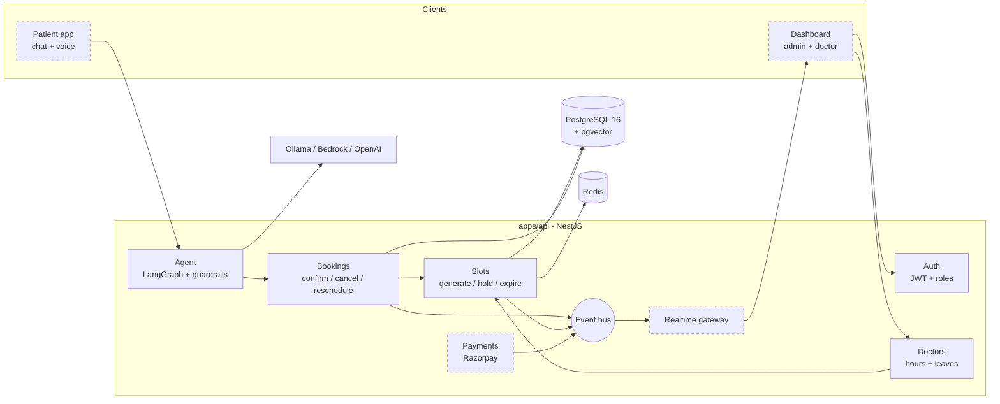
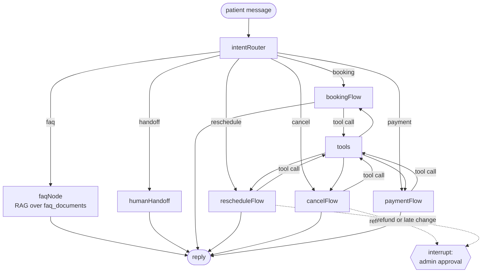

# AI Appointment Booking Agent

Patients talk to an AI agent (chat, then voice) to find a doctor, book, reschedule,
cancel and pay for a clinic appointment. Admins and doctors manage schedules and
bookings from a dashboard. Slot allocation is automatic.

## Status

| Phase | Scope | State |
|---|---|---|
| 1 | Monorepo, docker-compose, Prisma schema, migration, seed, JWT auth | Done |
| 2 | Slots, hold, confirm, cancel, reschedule, jobs, event bus, tests | Done |
| 3 | LangGraph agent, tools, FAQ RAG, memory, chat endpoint | Done |
| 4 | Patient chat app, admin/doctor dashboard | Next |
| 5 | Razorpay test payments, webhooks, email | Planned |
| 6 | Browser voice mode with barge-in | Planned |
| 7 | Langfuse tracing, cost tracking, agent evals | Planned |
| 8 | AWS CDK deploy, GitHub Actions CI | Planned |

## Architecture

Solid boxes exist today; dashed boxes arrive in later phases.



## Repository layout

```
apps/api            NestJS API: auth, doctors, slots, bookings, events
  prisma/           schema, migrations, seed
  test/             Supertest e2e tests
  src/agent/        chat endpoint, approvals, FAQ search, backend adapter
packages/agent      LangGraph graph, tools, prompts, guardrails (no NestJS or Prisma)
packages/llm        chat + embedding providers: ollama | bedrock | openai
packages/shared     zod schemas and types shared by API, agent and frontends
docker-compose.yml  postgres (pgvector) + redis
```

`apps/patient-app`, `apps/dashboard`, `evals/` and `infra/cdk` are added in their phases.

## Setup

Requirements: Node 22+, pnpm 9, Docker, and (for local chat) [Ollama](https://ollama.com).

```bash
cp .env.example .env        # then set JWT_SECRET and the two SEED_*_PASSWORD values
pnpm install
pnpm infra:up               # postgres on :5440, redis on :6380
pnpm --filter @clinic/api db:deploy   # apply migrations
pnpm db:seed                # 1 admin, 5 doctors, 2 weeks of slots, 10 FAQs
pnpm dev                    # API on http://localhost:4000
```

### Language model

`LLM_PROVIDER` in `.env` switches both chat and embeddings.

| Provider | Setup |
|---|---|
| `ollama` (default) | `ollama pull qwen2.5:3b` and `ollama pull mxbai-embed-large` |
| `bedrock` | AWS credentials with model access; set `BEDROCK_CHAT_MODEL` |
| `openai` | `OPENAI_API_KEY` |

After changing the embedding provider, re-embed the FAQs once:
`POST /faq/reindex` as admin. All providers produce 1024-dimension vectors, so no
migration is needed.

The local default is a 1.9 GB model because Docker plus a 4 GB model does not
fit in 8 GB of RAM. It handles straightforward conversations; see
"What a small model can and cannot do" below.

Postgres and Redis use host ports 5440 and 6380 so they do not clash with other
local databases. Change them in `docker-compose.yml` and `.env` together.

### Tests

```bash
pnpm test        # unit tests (API and agent)
pnpm test:e2e    # Supertest e2e against a separate clinic_test database
```

The e2e suite creates and migrates `clinic_test` on its own and uses Redis
database 1, so it never touches dev data. No language model is needed: the agent
tests replace it with a scripted stand-in.

### Trying it by hand

Seeded logins are `SEED_ADMIN_EMAIL` and the doctor emails in
`apps/api/prisma/seed.ts` (for example `rohan.mehta@clinic.test`), with the
passwords from your `.env`.

```bash
# log in as admin
curl -s -X POST localhost:4000/auth/login -H 'content-type: application/json' \
  -d '{"email":"admin@clinic.test","password":"<SEED_ADMIN_PASSWORD>"}'

# anonymous patient token, as the chat app will use
curl -s -X POST localhost:4000/auth/guest

# find a doctor and their free slots
curl -s 'localhost:4000/doctors?specialization=cardio'
curl -s 'localhost:4000/doctors/<doctorId>/slots?date=2026-11-18'

# hold, then confirm (TOKEN = any accessToken from above)
curl -s -X POST localhost:4000/slots/<slotId>/hold -H "authorization: Bearer $TOKEN" \
  -H 'content-type: application/json' -d '{"holderKey":"my-chat-session-1"}'
curl -s -X POST localhost:4000/bookings -H "authorization: Bearer $TOKEN" \
  -H 'content-type: application/json' -d '{
    "slotId":"<slotId>","holderKey":"my-chat-session-1","idempotencyKey":"booking-attempt-1",
    "patient":{"name":"Asha Verma","phone":"9876543210"}}'

# talk to the agent (TOKEN from /auth/guest; reuse the same sessionId for the whole conversation)
curl -s -X POST localhost:4000/chat -H "authorization: Bearer $TOKEN" \
  -H 'content-type: application/json' \
  -d '{"sessionId":"3f0e8d6a-58a1-4c3e-9a55-0d1f6e2b7c10","message":"I want to book an appointment with a heart doctor"}'
# then send, one message at a time: "tomorrow", "11:00 AM", "Asha Verma", "9876501234", "yes"

# cancel as the patient (phone proves ownership) or as admin (no phone needed)
curl -s -X POST localhost:4000/bookings/<bookingId>/cancel -H "authorization: Bearer $TOKEN" \
  -H 'content-type: application/json' -d '{"phone":"9876543210","reason":"Changed plans"}'
```

## API

| Method | Path | Access |
|---|---|---|
| POST | `/auth/login`, `/auth/guest` | public |
| GET | `/auth/me` | any token |
| GET | `/users` | ADMIN |
| GET | `/doctors`, `/doctors/:id`, `/doctors/:id/slots?date=` | public |
| POST / PATCH | `/doctors`, `/doctors/:id` | ADMIN |
| PUT | `/doctors/:id/working-hours` | ADMIN, own DOCTOR |
| GET / POST / DELETE | `/doctors/:id/leaves` | ADMIN, own DOCTOR |
| GET | `/doctors/:id/slots/all?from=&to=` | ADMIN, DOCTOR |
| POST / DELETE | `/slots/:id/hold` | any token |
| POST | `/slots/generate` | ADMIN |
| POST | `/bookings` | any token |
| GET | `/bookings`, `/bookings/:id` | ADMIN, DOCTOR (own only) |
| POST | `/bookings/:id/cancel`, `/bookings/:id/reschedule` | ADMIN, own DOCTOR, PATIENT with matching phone |
| POST | `/chat` | any token |
| GET | `/chat/:sessionId` | the session's owner |
| GET | `/approvals?status=` | ADMIN |
| POST | `/approvals/:id/decision` | ADMIN |
| POST | `/faq/reindex` | ADMIN |

## Interview notes

### Double-booking prevention

Three layers, each cheaper and less trustworthy than the next.

1. **Redis `SET NX EX`** on `hold:slot:<id>`. When two people tap the same slot
   the loser is rejected in one round trip without touching Postgres. This is a
   fast path only. If Redis is down the code logs a warning and carries on.
2. **Conditional `UPDATE` in Postgres.** Holding runs
   `UPDATE slots SET status='HELD' ... WHERE id=? AND (status='FREE' OR hold expired OR held by me)`.
   The check and the write are one atomic statement, so of N concurrent
   requests exactly one changes a row. Confirming does the same from `HELD` to
   `BOOKED`, checking the caller still owns a live hold.
3. **Partial unique index** `bookings(slot_id) WHERE status <> 'CANCELLED'`.
   Even a buggy code path that skips the service cannot insert a second active
   booking. It is partial so a slot can be rebooked after a cancellation.

The e2e suite proves each layer: 20 concurrent holds give one winner, the same
with Redis mocked as unavailable, and a raw insert that bypasses the service is
rejected by the database.

### Idempotency

- `holdSlot` is keyed by `holderKey` (the chat session). Holding again with the
  same key refreshes the hold instead of failing.
- `confirmBooking` takes an `idempotencyKey` with a unique index. A retry
  returns the first booking. Five identical requests sent at once produce one
  booking and five identical responses: the losers of the race look the
  winner up by key rather than surfacing a conflict.
- `cancel` on a cancelled booking and `reschedule` to the current slot are no-ops.
- Slot generation relies on `UNIQUE(doctor_id, start_time)` and
  `skipDuplicates`, so the job can run any number of times.

This matters more with an LLM in the loop: models retry tool calls and
occasionally call the same tool twice.

### Slot lifecycle

`FREE → HELD → BOOKED`, with `HELD → FREE` when a hold expires (a job runs every
minute; availability queries also treat an expired hold as free, so nothing waits
on the job). Generation is a sync rather than an append: it computes the desired
slots from working hours minus leaves, adds what is missing and removes free
slots that no longer belong. Booked slots inside a new leave are never deleted;
they are reported as `conflicts` for an admin to resolve. A fourth status,
`BLOCKED`, parks a slot that is outside the schedule but still referenced by an
old booking.

### Time

Everything is stored in UTC. Working hours are wall-clock times in
`CLINIC_TIMEZONE` and converted per day, so the generator is correct across
daylight-saving changes (covered by a unit test).

### Auth

Guards depend on an `AuthProvider` interface with `login`, `issueGuestToken` and
`verifyToken`. `LocalJwtAuthProvider` implements it now; a Cognito provider can
replace it without touching guards or controllers. Patients chat as anonymous
guests and become a patient record (keyed by phone) when they book. To change a
booking over REST a patient must supply the phone it was made with, and a wrong
phone gets the same 404 as a missing booking.

### Events

Services publish typed domain events (`booking.created`, `slot.held`, ...) to an
`EventBus` interface. The in-memory implementation isolates subscriber failures,
so a broken email handler cannot fail a booking. Swapping in SQS or EventBridge
means writing one class.

### Decisions that differ from the obvious

- **No vector index.** With ten FAQ rows an exact scan is faster than HNSW, and
  Prisma Migrate would try to drop an index it cannot describe.
- **Money is never refunded automatically.** Cancelling a paid booking sets
  `REFUND_PENDING`; an admin approves it (phase 3 wires this to a LangGraph
  interrupt).
- **Pinned majors**: NestJS 11, Prisma 6, TypeScript 5, zod 3.

### Agent graph



- **Router.** Unmistakable wording ("cancel my appointment") is routed by regex.
  A plain answer in the middle of a flow ("tomorrow", "yes") stays in that flow.
  Only what is left goes to the model. Most turns need no classifier call.
- **Flows.** Each flow is a tool-calling loop that sees only its own tools, so
  a cancel conversation cannot create a booking.
- **Tools.** `searchDoctors`, `getAvailableSlots`, `holdSlot`, `confirmBooking`,
  `getBookingStatus`, `cancelBooking`, `rescheduleBooking`, `createPaymentLink`,
  `transferToHuman`. All are zod-validated and idempotent: the hold is keyed by
  the conversation id and the booking by `conversation:slot`, so a repeated
  tool call cannot create a second booking.
- **Ports and adapters.** `packages/agent` talks to a `ClinicBackend`
  interface. The API implements it over the real services; tests implement it
  in memory. The agent package has no NestJS, Prisma or Redis dependency.
- **Memory.** The LangGraph Postgres checkpointer stores each conversation
  under its thread id, in its own `langgraph` schema so Prisma Migrate never
  sees those tables. A conversation survives an API restart. The thread id
  includes the caller's user id, so one user cannot read or continue another's
  conversation.
- **Human approval.** Cancelling a paid booking, or changing one inside the
  policy window, makes the tool call `interrupt()`. The graph pauses, an
  `approval_requests` row appears for the dashboard, and the admin's decision
  resumes the graph with `Command({ resume })`. The tool then runs again from
  the top, which is safe because every backend call is idempotent.

### Guardrails: the model proposes, the code disposes

The first real run with a small model produced this: it skipped every tool,
listed a dermatologist as a "heart doctor", and announced a booking ID that did
not exist. A later run created a real booking for "[Patient Name]" with an
invented phone number. Prompt rules did not stop either. What did:

1. **Progress from tool results** (`progress.ts`). Where the conversation
   stands (doctors found, slot held, booking made) is rebuilt every turn from
   the tool results in the checkpoint, never from what the model says.
2. **One step at a time** (`prompts.ts`). The system prompt contains only the
   current status and the next step, generated from that progress, plus hints
   computed in code: "tomorrow means 2026-11-18", "the patient asked for 11:00,
   which is slotId=...".
3. **Fast path** (`autopilot.ts`). When exactly one tool call makes sense (the
   patient picked a listed time; name, phone and a yes are all present), the
   code makes the call and the model is not asked. This is also the cheapest
   and fastest path.
4. **Tool-call policy** (`guard.ts`). Before a tool runs, its arguments are
   checked against what the patient typed: the booking name and phone must be
   theirs, the held time must be the one they asked for, the date must be one
   they named, and cancel/confirm need an explicit yes.
5. **Reply check** (`guard.ts`). Before a reply is sent, it is checked against
   tool results: no "booked" without a booking, no doctor, booking ID, link or
   phone number that did not come from a tool, no "please hold".
6. **One retry, then a script** (`templates.ts`). A rejected output gets one
   retry with the reason. If that fails too, the patient gets a scripted
   message built from tool results. The outcome of a booking, cancellation or
   reschedule is always a template, never model text.

All six are plain code and are covered by unit tests that script a model
behaving badly on purpose.

### What a small model can and cannot do

Measured on an 8 GB M2 with `qwen2.5:3b`:

- Straightforward paths work end to end: book, reschedule, cancel with staff
  approval, FAQ answers, handoff.
- Latency is about 1-15 seconds per turn warm; turns served by the fast path
  take under 100 ms.
- It still gets things wrong when the patient is vague or goes off script:
  it may offer all doctors for a specific symptom, ask a redundant question,
  or need the patient to repeat a detail. The guardrails turn these into a
  slower conversation rather than a wrong booking.
- Not every false sentence can be caught by pattern checks. For example it
  once said payment could be made online before that feature existed.

A larger model (Bedrock Claude Haiku or Nova Lite) should need the retry and
the script far less often. Phase 7 measures this with 20 scripted
conversations.

### Latency and cost

- Router by regex first, model last: most turns make one model call, not two.
- The fast path removes the model call entirely for determined steps.
- The static part of the system prompt comes first and the per-turn status
  last, so providers can reuse a cached prompt prefix.
- History sent to the model is capped at 14 messages; the facts it needs are
  in the status block.
- Every model call in a turn, including retries, is counted by a callback and
  stored per session: `input_tokens`, `output_tokens`, `cost_usd`, `latency_ms`.
  The price table in `packages/llm/src/pricing.ts` is hand-maintained; check it
  against the provider's pricing page before relying on a cost figure.

### Privacy

Transcripts are stored with phone numbers and emails masked, and log lines
mask them too. Provider errors are logged, never shown to the patient.
